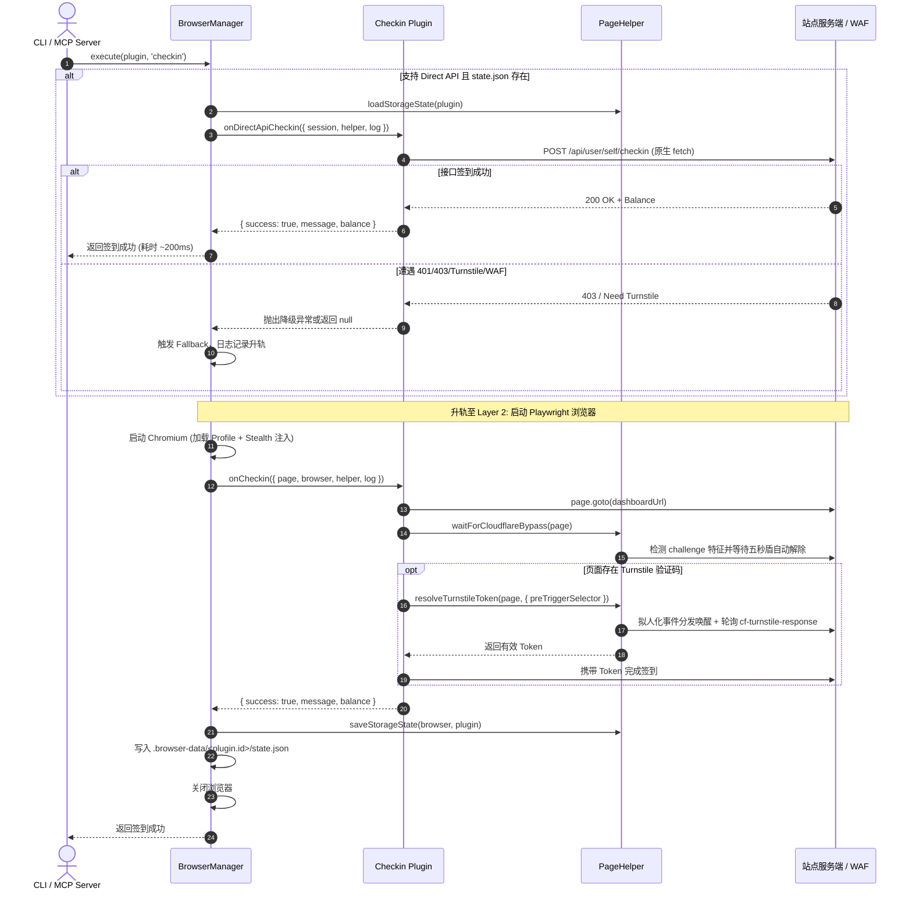

# 双层签到执行引擎与 Cloudflare/Turnstile 人机验证套件架构设计

- **日期**：2026-10-12
- **状态**：Approved (已确认)
- **参考借鉴**：
  - [1L426/Newapi-check](https://github.com/1L426/Newapi-check)（双层签到调度、直接 API 签到、Token 缓存）
  - [qixing-jk/all-api-hub](https://github.com/qixing-jk/all-api-hub)（打分制 Cloudflare 挑战探测、Turnstile 拟人化唤醒与 Token 捕获）

---

## 1. 背景与目标

### 1.1 现状与痛点

1. **浏览器冷启动开销高**：Checkin-Hub 当前针对所有已启用站点，每次打卡均会冷启动一个完整的 Chromium 实例，消耗较多 CPU/内存，且频繁启动新进程容易触发部分 API 聚合站的 WAF 频控。
2. **缺乏显式 Cloudflare 盾感知与等待**：在遇到 Cloudflare 五秒盾（Bot Fight Mode）时，框架仅依赖注入的 Stealth 脚本，缺乏状态判定；若页面渲染滞后，极易因选择器等待超时而直接报错。
3. **缺失 Cloudflare Turnstile 验证码支持**：许多 NewAPI / OneAPI 站点开启了签到人机验证（接口要求 `?turnstile=<token>`），当前各插件无法自动提取 Turnstile Token 完成签到。

### 1.2 建设目标

1. **人机验证套件 (CAPTCHA & WAF Suite)**：
   - 在 `core/helper.js` 中实现**打分制 Cloudflare 质询检测**与智能等待放行；
   - 在 `core/helper.js` 中实现**零外部依赖的 Cloudflare Turnstile 拟人化唤醒与 Token 捕获**助手；
2. **双层执行引擎 (Dual-Layer Execution Engine)**：
   - **Layer 1: Direct API 极速通道**：通过 Node.js 原生 `fetch` 发起签到，响应时间降至 100~300ms；
   - **Layer 2: Playwright 浏览器兜底**：当 Direct API 遭遇 401/403/WAF/Turnstile 时，平滑升轨至浏览器进行真实页面交互与过盾；
3. **会话状态自动同步 (Automatic Storage State Sync)**：
   - 浏览器成功打卡或 Setup 后，框架自动将 Cookies 和 LocalStorage 导出至 `.browser-data/<plugin.id>/state.json`，Direct API 零配置开箱即用；
4. **渐进式兼容与零破坏**：
   - 保持现有插件 100% 向后兼容；
   - 保持现有 Native Unit Tests、ESLint 及插件契约校验 100% 通过。

---

## 2. 总体架构与数据流

### 2.1 签到生命周期时序图



---

## 3. 详细设计与核心组件规范

### 3.1 人机验证与辅助工具集 (`core/helper.js`)

在 `PageHelper` 类中新增以下静态方法：

#### 3.1.1 打分制 Cloudflare 挑战检测

```javascript
/**
 * 打分制 Cloudflare 质询状态检测
 * @param {import('playwright').Page} page
 * @returns {Promise<{ isChallenge: boolean, score: number, strong: string[], medium: string[], weak: string[] }>}
 */
static async detectCloudflareChallenge(page)
```

- **评分指标**：
  - **强特征 (+3)**：`window._cf_chl_opt`、存在 `challenge-platform` / `trace-jsch` 外部脚本、`form#challenge-form` / `form[action*="challenge"]`；
  - **中特征 (+2)**：`#cf-content`、`#cf-wrapper`、页面文本含 `Error 1020` 或 `Access denied`、URL 包含 `/cdn-cgi/`；
  - **弱特征 (+1)**：标题包含 `Just a moment` / `Attention Required` / `Please Wait`、存在 `.cf-turnstile`。
- **判定规则**：
  `isChallenge = strong.length > 0 || (score >= 3 && (medium.length > 0 || weak.length > 0))`。

#### 3.1.2 Cloudflare 挑战智能等待

```javascript
/**
 * 等待 Cloudflare 质询自动放行
 * @param {import('playwright').Page} page
 * @param {Object} [options]
 * @param {number} [options.timeoutMs=30000] 最大等待时间
 * @param {number} [options.pollIntervalMs=500] 检查轮询间隔
 * @returns {Promise<boolean>} 是否成功放行
 */
static async waitForCloudflareBypass(page, options = {})
```

- **逻辑**：首先快速执行 `detectCloudflareChallenge`。若未检出盾，立即返回 `true`（耗时 $<5\text{ms}$）；若检出盾，以 `pollIntervalMs` 轮询直至挑战消失或超时。

#### 3.1.3 Cloudflare Turnstile 拟人化唤醒与 Token 捕获

```javascript
/**
 * 唤醒 Turnstile 组件并提取单次有效 Token
 * @param {import('playwright').Page} page
 * @param {Object} [options]
 * @param {string} [options.preTriggerSelector] 预触发按钮选择器（如懒加载时的“签到”按钮）
 * @param {number} [options.timeoutMs=25000] 最大等待时间
 * @param {number} [options.pollIntervalMs=300] Token 轮询间隔
 * @returns {Promise<string>} Turnstile Token 字符串
 */
static async resolveTurnstileToken(page, options = {})
```

- **核心逻辑**：
  1. 若配置了 `preTriggerSelector` 且组件尚未渲染，先安全点击该选择器；
  2. 定位 Turnstile 容器元素（`.cf-turnstile` 或 `iframe[src*="turnstile"]`）；
  3. 执行拟人化事件分发（`simulateClick`），模拟真人交互触发后台计算：
     - `new PointerEvent("pointerdown", { bubbles: true, cancelable: true, composed: true })`
     - `new PointerEvent("pointerup", { ... })`
     - `new MouseEvent("mousedown", { ... })`
     - `new MouseEvent("mouseup", { ... })`
     - `element.click()`
  4. 轮询 `input[name="cf-turnstile-response"]` 的 `value`。一旦非空，立即返回该 Token；
  5. 若超时，抛出带有明确诊断信息的异常。

#### 3.1.4 状态持久化与凭据组装 (`SessionManager`)

```javascript
/**
 * 保存浏览器存储状态至 profile 目录下的 state.json
 * @param {import('playwright').BrowserContext} browser
 * @param {string} statePath
 */
static async saveStorageState(browser, statePath)

/**
 * 读取并组装供原生 fetch 使用的 session 凭据
 * @param {string} statePath
 * @returns {{ cookies: string, headers: Record<string, string>, rawState: Object } | null}
 */
static loadSessionFromState(statePath)
```

- **读取解析规约**：
  - 提取 `cookies` 数组，组装为 `Cookie: name=val; name2=val2` 字符串；
  - 遍历 origins 中的 `localStorage`，若存在 `user`，解析获取 `id`（映射至 `New-Api-User` 头）；
  - 若存在 `token`、`access_token` 或 `session`，组装 `Authorization: Bearer <token>` 请求头。

---

### 3.2 插件基类扩展 (`core/base-plugin.js`)

在 `BasePlugin` 中新增可选生命周期钩子：

```javascript
class BasePlugin {
  constructor({ id, name, description, url, loginUrl, enabled = true }) {
    // 保持原有字段...
  }

  /**
   * [可选] Direct API 极速打卡通道
   * 默认返回 null，表示不启用或由浏览器处理
   * @param {Object} context
   * @param {Function} context.log 日志记录器
   * @param {typeof PageHelper} context.helper 辅助工具类
   * @param {Object} context.session 预解析的会话凭据 { cookies, headers, rawState }
   * @returns {Promise<{ success: boolean, message: string, balance?: string } | null>}
   */
  async onDirectApiCheckin(context) {
    return null;
  }

  /**
   * [必须] 浏览器打卡核心逻辑
   */
  async onCheckin(context) {
    throw new Error(`Plugin [${this.id}] must implement onCheckin()`);
  }
}
```

---

### 3.3 浏览器与调度管理引擎 (`core/browser-manager.js`)

更新 `execute(plugin, action, runtimeOptions)` 的执行调度流：

1. **路径解析**：定义 `statePath = path.join(userDataDir, 'state.json')`。
2. **Direct API 判定**：
   - 当 `action === 'checkin'`、`!runtimeOptions.forceBrowser`、`typeof plugin.onDirectApiCheckin === 'function'` 且 `fs.existsSync(statePath)` 时：
   - 加载 session：`const session = PageHelper.loadSessionFromState(statePath)`；
   - 调用 `const result = await plugin.onDirectApiCheckin({ log, helper: PageHelper, session })`；
   - 若 `result?.success === true`：直接记录成功日志并返回结果，**零启动 Chromium**；
   - 若返回 `null` 或抛出异常（如 HTTP 401/403/WAF）：
     记录日志：`[plugin.name] Direct API 触发质询或凭据过期，平滑转入 Playwright 浏览器兜底...`，自动降级至浏览器流程。
3. **浏览器执行与状态刷新**：
   - 启动 Playwright Persistent Context；
   - 执行 `onCheckin`；
   - 在执行成功且即将关闭浏览器前，调用 `await PageHelper.saveStorageState(browser, statePath)`。

---

## 4. 典型插件适配示例 (`plugins/anyrouter.js`)

以 AnyRouter 为例，为其增加 `onDirectApiCheckin` 支持：

```javascript
async onDirectApiCheckin({ log, session }) {
  if (!session || !session.cookies) return null;

  log('尝试通过 Direct API 极速通道检查签到状态...');
  const baseUrl = 'https://anyrouter.top';

  // 1. 获取用户信息与近期日志预检
  const res = await fetch(`${baseUrl}/api/log/self?p=1&page_size=10&type=4`, {
    headers: {
      'Cookie': session.cookies,
      ...session.headers,
    },
  });

  if (res.status === 401 || res.status === 403) {
    log('会话失效或遇到安全拦截，转入浏览器处理');
    return null;
  }

  const logData = await res.json().catch(() => null);
  // 若今日已签到，获取当前余额直接返回
  // 若未签到或需要重新认证，返回 null 触发浏览器处理
  // ...
}
```

---

## 5. 错误处理与降级规约

1. **Direct API 降级准则**：
   - 任何网络超时、JSON 解析错误、HTTP 401/403/5xx 均作为“降级信号”，严禁在 Direct API 阶段直接终止打卡任务；
   - 统一捕获异常并转入 Playwright 浏览器执行。
2. **Turnstile 超时诊断**：
   - 若在指定时间（默认 25s）内未能捕获 Turnstile Token，抛出明确诊断信息：
     `new Error("Turnstile 验证码未在限定时间内完成，可能受限于当前网络 IP 信誉，请运行 node index.js --setup <id> 进行一次交互式人工验证")`。
3. **现场存证保持**：
   - 无论何时，Playwright 阶段只要发生失败，自动截取现场屏幕保存至 `screenshots/<plugin_id>-<timestamp>.png`。

---

## 6. 测试与质量保障策略

1. **单元测试 (`test/helper.test.js`)**：
   - 测试 `detectCloudflareChallenge` 的打分矩阵：强特征、中特征、弱特征组合以及非质询页面的判定；
   - 测试 `resolveTurnstileToken` 的拟人化事件分发与轮询提取逻辑；
   - 测试 `loadSessionFromState` 对 cookies 与 localStorage 的解析正确性。
2. **基类契约测试 (`test/base-plugin.test.js`)**：
   - 验证 `onDirectApiCheckin` 默认返回 `null`。
3. **调度引擎测试 (`test/browser-manager.test.js`)**：
   - 验证 `execute` 在 Direct API 成功时不拉起浏览器；
   - 验证 `execute` 在 Direct API 失败时平滑降级至 Playwright 并刷新 `state.json`。
4. **代码规范与工程校验**：
   - `npm run check` 必须 100% 通过（ESLint、Prettier、Unit Tests 与 verify-plugins 契约扫描均无报错）。
